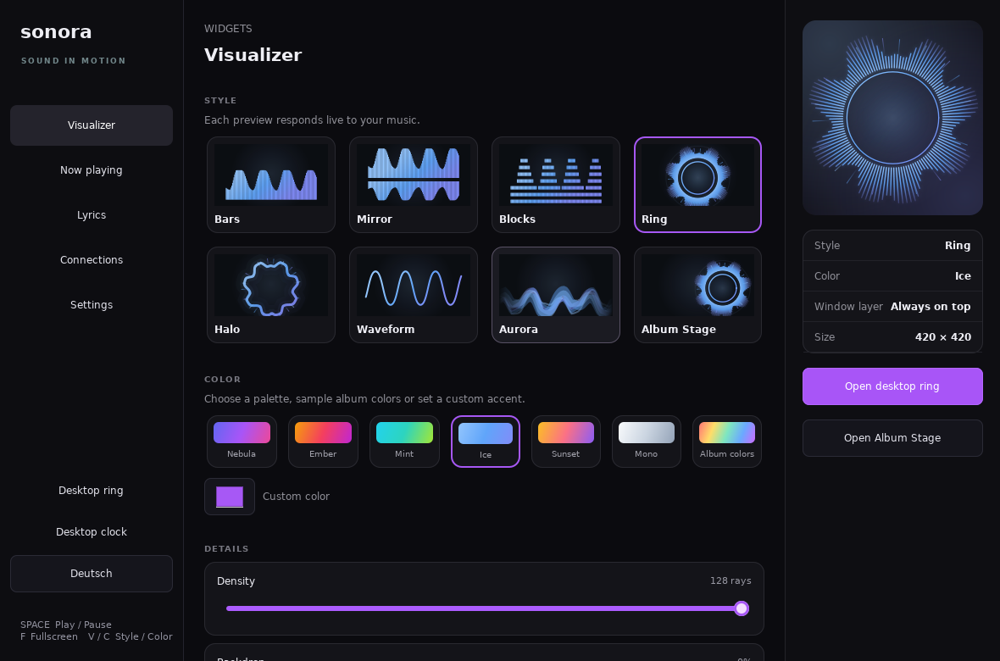
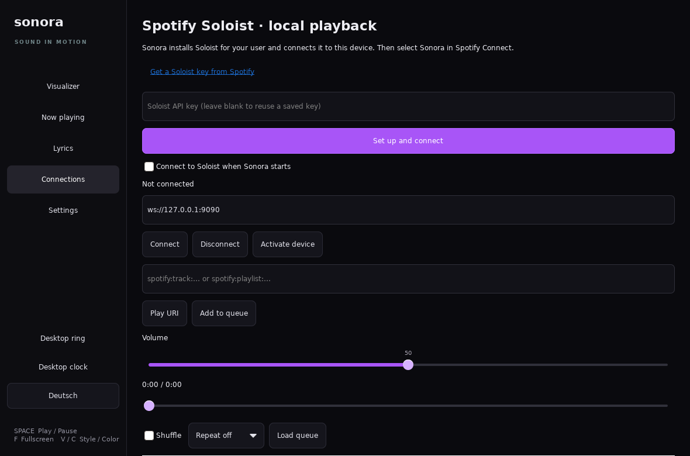
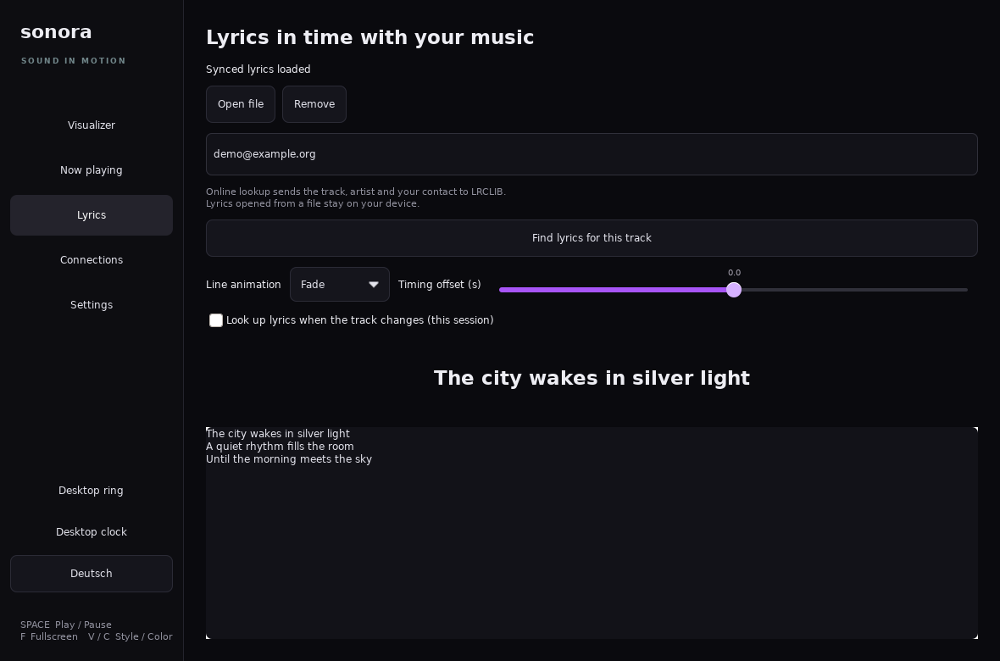

# Sonora for Linux

Sonora turns the sound playing on your Linux desktop into a live visualizer. You can keep a small interactive ring above other windows, put a track and its lyrics on the desktop, or fill the screen with a visualization. Sonora controls music through MPRIS and Spotify Soloist.



*The screenshots show Sonora 0.7.0 in English. The visualizer and lyrics examples use demo audio and sample lyrics.*

## Install Sonora

1. On Debian, Ubuntu or Pop!_OS, download [the 0.7.0 Debian installer](https://github.com/niklasptrs/sonora/releases/tag/v0.7.0) or build `sonora_0.7.0_all.deb`. If you have the source folder, run `./package.sh` inside it. The script writes the package one directory above the source folder.
2. From the directory containing the package, run the following command. APT installs the GTK, audio capture and WebSocket dependencies and upgrades an existing Sonora package in place.

   ```sh
   sudo apt install ./sonora_0.7.0_all.deb
   ```

3. Launch **Sonora** from the application menu, or run `sonora` in a terminal within your graphical session.
4. Click **English** near the bottom of the left sidebar. The interface changes immediately. Click **Deutsch** to switch back. Sonora remembers your choice when you reopen it.
5. Start a song in a desktop music player. Open **Now playing** to check the track and **Visualizer** to see the output respond. To try the visuals with synthetic audio, close Sonora and run `sonora --demo`.

### Run from source

On a Debian-based system with Python 3.10 or later, install the runtime packages once. Then start Sonora from its source folder.

```sh
sudo apt install python3-gi python3-gi-cairo gir1.2-gtk-3.0 gir1.2-gtklayershell-0.1 python3-numpy pulseaudio-utils python3-websocket
./run.sh
```

For a per-user application menu entry, run `./install.sh` from the same folder. PipeWire with PulseAudio compatibility or a PulseAudio server supplies the audio stream.

## Set up Spotify Soloist inside Sonora



1. Open **Connections**. On a new installation, click **Get a Soloist key from Spotify** and generate a personal Soloist API key with your Spotify Premium account. [Spotify account and pairing instructions](https://developer.spotify.com/documentation/soloist/tutorials/getting-started)
2. Paste the key in the masked field. If Soloist has already saved your key, leave the field blank.
3. Click **Set up and connect**. Sonora checks for a usable installed build. If needed, it downloads the official Linux archive for your CPU, checks the executable, and installs it for your user. Supported builds cover x86-64, ARM64 and ARMv7. Setup runs in the background and needs no administrator password. Spotify builds expire after 90 days. Running setup again replaces an expired build. [Official builds and update policy](https://developer.spotify.com/documentation/soloist/reference/downloads-and-updates)
4. For first-time pairing, open the Spotify app on a device on the same local network. Open the device picker and select **Sonora**. Start a track. An existing Soloist instance may advertise its own device name.
5. Return to **Now playing**. The track, playback position and transport controls should follow Soloist. Successful setup enables **Connect to Soloist when Sonora starts**. Clear the checkbox if you prefer to connect manually.

Sonora passes a new key to Soloist through standard input. Soloist stores the key and its Spotify session. Sonora starts its own player on an available loopback port and fills in its address automatically. If a Soloist instance is already listening, setup can connect to it. To attach to a specific local instance, enter its WebSocket address under **Connections** and click **Connect**.

**Disconnect** turns off automatic connection and stops a player started by Sonora. Closing Sonora also stops that player. An independently started Soloist instance has its own lifetime. To rotate its key, enter the replacement under **Connections**, run setup, then restart the external instance when prompted.

## Music, audio and visuals

| Control | What it does |
| --- | --- |
| **Now playing** | Shows track information, elapsed time, duration and artwork when the player provides them. Use the transport buttons to pause, resume or skip. |
| **Settings → Audio → MPRIS player** | Selects a running desktop player. Automatic selection prefers Spotify among available MPRIS players. A connected, signed-in Soloist takes priority. |
| **Settings → Audio → Audio source** | Selects the signal that drives the visuals independently of the player controls. Leave it empty for the default output monitor. After changing audio outputs, click **Reconnect audio**. Use `pactl list short sources` to list available source names. |
| **Connections** | Controls Soloist volume, seeking, shuffle and repeat. Paste a Spotify track or playlist URI to play it or add it to the queue. **Load queue** requests up to 80 upcoming entries. |
| **Visualizer → Style** | Choose Bars, Mirror, Blocks, Ring, Halo, Waveform, Aurora or Album Stage. Each tile previews the same audio. Album Stage pairs the visualization with artwork and lyrics. |
| **Color and details** | Select a palette, sample colors from the album art or choose an accent. Density controls the number of rays. Sensitivity changes their response to sound, decay controls their fall after a beat, and glow changes the lighting around them. |
| **Settings → Fullscreen** | Choose a separate style, palette and background for fullscreen and decide whether to show synced lyrics. The Dashboard choice follows the main visualizer. |
| **Desktop clock** | Opens a separate clock. Choose Digital, Stacked, Minimal, Analog or Words in **Settings → Appearance**. |
| **Settings → Desktop & profiles** | Save named combinations of audio and appearance settings, load or delete them, and choose whether Sonora starts at login. |

### Use the desktop ring

- Toggle **Visualizer → Desktop scene → Show desktop ring** to turn the ring on or off. Sonora saves this setting. The track card, desktop lyrics and screen-edge glow have independent switches.
- **Drag** the ring to move it. **Click** to toggle the track card, **double-click** to cycle styles, and **right-click** to open ring options. Hover for playback controls or drag the resize handle.
- Choose **Small**, **Medium**, **Large** or **Wide** under **Size**. The ring remembers a position for each size. **Full-width banner** spans the current monitor. **Reset position** brings the ring back to the center.
- Select a window layer to keep the ring above other windows, show it as a normal window or place it on the desktop. Layer support depends on the X11 window manager or Wayland compositor. **Lock widget** and **Let clicks pass through** are useful over other apps. Use the dashboard to regain mouse interaction.
- The optional track card shows the current song and up to three upcoming tracks when Soloist or the MPRIS player supplies a queue. Drag the card or floating lyrics to place them independently.

## Display lyrics



**From a file.** Open **Lyrics → Open file** and choose a UTF-8 `.lrc` or `.txt` file. Timestamps synchronize lines to the current song position. Plain text appears in the reading pane. For a small timed example, save the following as `example.lrc` and open it while a track plays.

```text
[00:00.00]The city wakes in silver light
[00:08.00]A quiet rhythm fills the room
[00:16.00]Until the morning meets the sky
```

**Online lookup.** Enter a contact email or project URL and click **Find lyrics for this track**. This sends the track information and your contact to LRCLIB. Sonora saves the contact locally. Clear the field to remove it. Enable **Look up lyrics when the track changes** to repeat lookups for the current session. Coverage and the availability of timed lyrics depend on the song.

**Animation and placement.** Choose Fade, Rise, Word reveal, Slide, Spring or Static. Use **Timing offset (s)** if lines appear early or late. Under **Visualizer → Desktop scene**, enable **Floating desktop lyrics** and adjust font size, line width and alignment. Enhanced LRC word timestamps enable word highlighting in supported layouts.

## Shortcuts and closing the app

| Shortcut | Action |
| --- | --- |
| Space | Play or pause |
| Left / Right | Previous / next track |
| V / C | Cycle style / palette |
| F / Esc | Toggle fullscreen / leave fullscreen |
| `sonora --toggle-widget` | Toggle the saved ring visibility |
| `sonora --fullscreen` | Toggle fullscreen in the running instance |
| `sonora --quit` | Exit Sonora |

Window shortcuts yield to text entry. Closing the dashboard exits Sonora, removes its overlays and stops audio capture. You can assign the command-line actions to shortcuts in your desktop settings.

## Troubleshooting

| Symptom | What to check |
| --- | --- |
| Track information appears but the visualizer stays still | Play audible sound on the selected output. In **Settings → Audio**, clear a stale source name and click **Reconnect audio**. |
| Visuals move but track information is missing | The audio stream and player metadata come from separate sources. Select the correct MPRIS player or pair Soloist through Spotify Connect. |
| Soloist is installed but setup asks for a key | Enter your personal Soloist key under **Connections** and click **Set up and connect** again. |
| Soloist is connected but waiting for sign-in | Select its device in Spotify Connect on the same local network. The local Sonora connection and Spotify account pairing are separate steps. |
| An update or download fails | Check that Spotify’s download site opens on this computer, then retry setup. Sonora verifies the replacement before moving it into place. |
| Lyrics appear as text but do not advance | Use a timed LRC file or a synced lookup result. The player must also report playback position. |
| A locked ring cannot be selected | Open **Visualizer → Window**, clear **Lock widget** and **Let clicks pass through**, or disable **Show desktop ring**. |

Sonora stores preferences and profiles under `~/.config/sonora/`. The per-user Soloist executable, when needed, is installed under `~/.local/share/sonora/bin/`. Soloist keeps its own data under `~/.local/share/soloist/`. These locations follow the corresponding XDG environment settings.

## Microphone visualizer for iPad

The [web app](web/index.html) runs in Safari and draws its visualizations from the device microphone. Serve the three files in `web/` together over HTTPS, open the site on the iPad, tap **Mikrofon starten**, and allow microphone access. Audio processing runs on the device.
